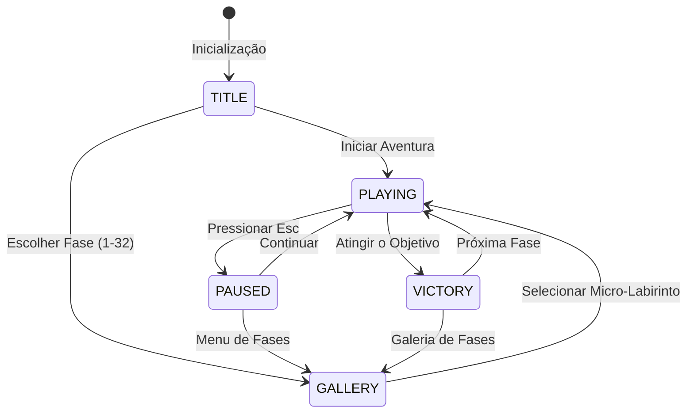

# 🎮 32 Even Smaller Mazes | 32 Labirintos de Alguma Forma Ainda Menores

[](https://react.dev/)
[](https://www.typescriptlang.org/)
[](https://vitejs.dev/)
[](https://tailwindcss.com/)
[](https://developer.mozilla.org/en-US/docs/Web/API/Web_Audio_API)
[](#)
[](LICENSE)

> **Inspirado em *20 Small Mazes* de FLEB e no ecossistema independente da Godot Engine.**  
> Um jogo de quebra-cabeça minimalista e tátil composto por **32 micro-labirintos**, cada um operando sob leis espaciais, mecânicas físicas e lógicas geométricas completamente distintas.

---

## 📑 Sumário / Table of Contents
1. [Visão Geral / Overview](#-visão-geral--overview)
2. [Níveis de Dificuldade / Difficulty Tiers](#-níveis-de-dificuldade--difficulty-tiers)
3. [Catálogo Completo das 32 Fases / Complete 32-Maze Catalog](#-catálogo-completo-das-32-fases)
4. [Controles e Atalhos / Controls](#-controles-e-atalhos--controls)
5. [Arquitetura de Software / Architecture](#-arquitetura-de-software--architecture)
6. [Game Feel e Feedback Tátil / Game Feel](#-game-feel-e-feedback-tátil)
7. [Síntese Sonora Procedural / Audio Engine](#-síntese-sonora-procedural)
8. [Instalação e Execução Local / Getting Started](#-instalação-e-execução-local)
9. [Scripts Disponíveis / Available Scripts](#-scripts-disponíveis)
10. [Licença e Créditos / Credits](#-licença-e-créditos)

---

## 🧭 Visão Geral / Overview

*32 Even Smaller Mazes* reimagina o conceito de labirintos ao compactá-los em dioramas micro-arquitetônicos de 4x4 a 6x6. Em vez de testar apenas a memória de navegação, cada fase introduz uma nova regra que desafia a intuição espacial do jogador:

- **Dioramas Táteis**: Renderização 2D/2.5D com profundidade de chanfro, iluminação ambiente suave e partículas de faísca.
- **Zero Assets Externos**: Todas as texturas, malhas de luz, ícones e efeitos sonoros são sintetizados matematicamente via código (`HTML5 Canvas` e `Web Audio API`).
- **Simulação Desacoplada a 60 FPS**: Motor de física e renderização isolado do ciclo de renderização do React, garantindo latência zero nas entradas.
- **Bilinguismo Nativo**: Suporte completo a **Português (Brasil)** e **English**.

---

## 🎯 Níveis de Dificuldade / Difficulty Tiers

O jogo é estruturado em **4 categorias de dificuldade calibradas**, cada uma com 8 fases originais:

| Nível / Tier | Fases | Descrição / Desafio | Cor Temática |
| :--- | :---: | :--- | :---: |
| 🟢 **Fácil (Easy)** | #01 a #08 | Introdução às mecânicas fundamentais: chaves, caixas sokoban, alternância de cores, portais e molas. | Verde Esmeralda (`#10b981`) |
| 🔵 **Médio (Medium)** | #09 a #16 | Desafios táticos com reflexão de lasers por prismas, gêmeos espelhados, engrenagens rotativas e lanterna na escuridão. | Azul Ciano (`#06b6d4`) |
| 🟡 **Difícil (Hard)** | #17 a #24 | Raciocínio avançado: pisos quebradiços de caminho hamiltoniano, dobras de folha (origami), matrizes de laser e loops de eco. | Âmbar Dourado (`#f59e0b`) |
| 🔴 **Hard Master** | #25 a #32 | O nível definitivo para mestres do puzzle: quebra-cabeças multifásicos com física combinada, circuitos de 4 nós e o Grande Paradoxo Soberano. | Rosa Choque (`#f43f5e`) |

---

## 🗺️ Catálogo Completo das 32 Fases

### 🟢 Nível Fácil (Fases 1 a 8)
1. **#01 - A Chave de Latão (The Brass Key)**: Colete a chave dourada e abra o portão de ferro. (Par: 8)
2. **#02 - Caixote Pesado (Heavy Crate)**: Empurre o bloco de madeira sobre o sensor de pressão losangular. (Par: 9)
3. **#03 - Troca de Cores (Color Shift)**: Alterne interruptores vermelhos e azuis para mudar barreiras ativas. (Par: 10)
4. **#04 - Gravidade Zero (Zero Gravity)**: Deslize contínuo sem atrito até colidir contra paredes sólidas. (Par: 6)
5. **#05 - Ruas de Mão Única (One-Way Alleys)**: Esteiras unidirecionais que impedem o retorno. (Par: 11)
6. **#06 - Nanoescala (Nanoscale)**: Absorva o prisma roxo de encolhimento para cruzar frestas milimétricas. (Par: 10)
7. **#07 - Par de Buracos de Minhoca (Wormhole Pair)**: Teletransporte euclidiano entre portais Laranja e Ciano. (Par: 8)
8. **#08 - Molas de Pinball (Pinball Springs)**: Trampolins helicoidais que saltam 2 blocos sobre fossos de espinhos. (Par: 8)

### 🔵 Nível Médio (Fases 9 a 16)
9. **#09 - Lago Congelado (Frozen Lake)**: Navegação por placas de gelo sem atrito entre pilares de neve. (Par: 7)
10. **#10 - Prisma e Laser (Prism & Laser)**: Gire espelhos a 90° (`Espaço`) para desviar o feixe até o sensor fotocélula. (Par: 8)
11. **#11 - Gêmeo de Sombra (Shadow Twin)**: Conduza duas esferas sincronizadas com movimento horizontal espelhado. (Par: 9)
12. **#12 - Engrenagem Mecânica (Clockwork Cog)**: Gire o miolo do labirinto em 90° pisando na engrenagem central. (Par: 10)
13. **#13 - Trilha de Silício (Silicon Trace)**: Ative os pinos condutivos do chip na ordem sequencial `1 → 2 → 3`. (Par: 11)
14. **#14 - Salto Magnético (Magnetic Leap)**: Inverta sua polaridade (`+` / `-`) para ser puxado por pilones opostos. (Par: 9)
15. **#15 - Vela no Escuro (Candle in the Dark)**: Catacumba com névoa de guerra onde você deve acender 2 braseiros rituais. (Par: 14)
16. **#16 - Translocador (Translocator)**: Plante sua baliza de coordenadas, entre na câmara e teleporte-se de volta. (Par: 9)

### 🟡 Nível Difícil (Fases 17 a 24)
17. **#17 - Chão Esfarelado (Crumbling Path)**: Ladrilhos dourados frágeis que colapsam no abismo após a passagem. (Par: 14)
18. **#18 - O Selo Postal (The Postage Stamp)**: Dobre a microfolha no picote para transitar entre a Frente e o Verso. (Par: 10)
19. **#19 - Eco Temporal (Echo Loop)**: Grave sua rota na placa de eco e solte seu clone fantasma para segurar a porta. (Par: 12)
20. **#20 - Matriz de Duplo Prisma (Dual Prism Array)**: Alinhamento óptico de trajetória de laser com múltiplos rebotes. (Par: 12)
21. **#21 - Cofre de Gelo e Cores (Ice & Color Vault)**: Deslizes sob gelo combinados com portas lógicas de cor. (Par: 13)
22. **#22 - Grade de Vetores Gêmeos (Twin Vector Grid)**: Entidades espelhadas navegando em esteiras de fluxo oposto. (Par: 12)
23. **#23 - Fogo Cruzado Magnético (Magnetic Crossfire)**: Saltos polares complexos sobre múltiplos fossos do vazio. (Par: 11)
24. **#24 - Salto e Molas (Vault & Springs)**: Cálculo de distância e ricochete em trampolins sob armadilhas. (Par: 10)

### 🔴 Nível Hard Master (Fases 25 a 32)
25. **#25 - Enigma do Fantasma Cronológico (Chrono Ghost Conundrum)**: Orquestração temporal com portas duplas temporizadas. (Par: 16)
26. **#26 - O Microchip de 4 Nós (The 4-Node Microchip)**: Sequenciamento eletrônico de 4 terminais em trilhas estreitas. (Par: 18)
27. **#27 - Paradoxo Rotativo (Rotary Paradox)**: Engrenagem mecânica orbital com portas que mudam a cada quarto de volta. (Par: 14)
28. **#28 - Dobra Dupla de Origami (Origami Double Fold)**: Labirinto bidimensional completo nos dois lados do papel. (Par: 16)
29. **#29 - Vazio das Sombras (Shadow Void)**: Esferas gêmeas coordenadas sobre piso quebradiço mortal. (Par: 15)
30. **#30 - Criogenia Zero-G (Cryo Zero-G)**: Deslize inercial contínuo com múltiplos ângulos de deflexão e paradas estritas. (Par: 14)
31. **#31 - Translocador Quântico (Quantum Translocator)**: Baliza de teletransporte através de portões unidirecionais. (Par: 13)
32. **#32 - O Grande Paradoxo: Soberano (The Grand Paradox: Sovereign)**: O ápice do jogo: caixotes, cores, portais, chaves e engrenagens em um quebra-cabeça de 6x6. (Par: 18)

---

## 🎮 Controles e Atalhos / Controls

| Ação | Teclado (Desktop) | Touch / Mobile |
| :--- | :---: | :---: |
| **Mover Jogador** | `W`, `A`, `S`, `D` ou `Setas` | D-Pad Virtual na tela |
| **Ação Especial** *(Girar Espelho, Dobrar Selo, Teleporte, etc.)* | `Espaço` ou `E` | Botão `SPACE` dedicado |
| **Desfazer Jogada (Undo)** | `Z` ou `Backspace` | Botão `Desfazer (Z)` |
| **Reiniciar Fase (Restart)** | `R` | Botão `Reiniciar (R)` |
| **Pausar / Menu de Fases** | `Esc` | Ícone de Menu no canto superior |
| **Ligar / Desligar Som** | `M` | Ícone de Alto-Falante no HUD |
| **Alternar Idioma (PT/EN)** | Menu / Tela Inicial | Botão de Idioma |

---

## 🏗️ Arquitetura de Software / Architecture

```
/
├── index.html                  # Ponto de entrada com meta-tags otimizadas
├── package.json                # Dependências limpas (React 19, Tailwind 4, Lucide)
├── metadata.json               # Configurações do ecossistema AI Studio
├── DOCUMENTATION.md            # Documentação técnica e guia de expansão
├── README.md                   # Documentação visual completa
└── src/
    ├── main.tsx                # Bootstrap da aplicação
    ├── App.tsx                 # Máquina de estados global e ciclo de vida
    ├── index.css               # Importação do Tailwind 4 e reset de viewport
    ├── types/
    │   └── game.ts             # Tipos TypeScript, interfaces de células e fases
    ├── audio/
    │   └── soundManager.ts     # Sintetizador procedural com Web Audio API
    ├── data/
    │   └── mazes.ts            # Definição dos 32 micro-labirintos (Fácil a Master)
    ├── game/
    │   └── GameEngine.ts       # Motor Canvas 60 FPS com squash & stretch, undo e física
    └── components/
        ├── TitleScreen.tsx     # Tela inicial imersiva com tipografia SVG exclusiva
        ├── GalleryScreen.tsx   # Mesa de trabalho / seletor de fases por dificuldade
        ├── GameHUD.tsx         # HUD de baixa oclusão (<15% da tela)
        ├── PauseModal.tsx      # Modal de pausa com configurações e volume
        ├── VictoryModal.tsx    # Modal de celebração com estrelas e par
        └── VirtualControls.tsx # Controles virtuais otimizados para touch
```

### Máquina de Estados da Aplicação


---

## ⚡ Game Feel e Feedback Tátil

O motor foi construído seguindo rigorosos princípios de **Game Feel**:
- **Simulação a 60 FPS com Delta Time Clamping**: `Math.min(rawDt, 0.05)` para evitar saltos de física após perda de foco.
- **Squash & Stretch Suave**: A esfera do jogador achata e estica responsivamente nos eixos de deslocamento e colisão.
- **Hitstop (30-80ms)**: Micro-congelamento deliberado ao coletar chaves, atingir sensores ou acionar engrenagens para conferir peso físico às ações.
- **Screen Shake Decrescente**: Trepidação sutil de câmera proporcional ao impacto.
- **Pilha Infinita de Desfazer (Undo Stack)**: Armazena o estado completo de blocos, espelhos, temporizadores e matrizes de chão para experimentação livre.

---

## 🔊 Síntese Sonora Procedural

Nenhum arquivo `.mp3` ou `.wav` pesado é carregado pela rede. O módulo `SoundManager` utiliza a **Web Audio API** nativa do navegador para criar:
- **Passos**: Osciladores triangulares com queda exponencial rápida de frequência (280Hz → 140Hz).
- **Deslizes**: Modulação senoidal contínua (520Hz → 880Hz).
- **Chaves & Braseiros**: Acorde harmônico duplo brilhante em E5 (659Hz) e B5 (987Hz).
- **Portais & Molas**: Curvas harmônicas ascendentes com ressonância via `BiquadFilterNode`.
- **Vitória**: Arpejo cerimonial maior nos tons `C5 → E5 → G5 → C6`.

---

## 🚀 Instalação e Execução Local

### Pré-requisitos
- **Node.js**: versão 18 ou superior
- **npm**: versão 9 ou superior

### Passo a Passo
```bash
# 1. Clone o repositório
git clone https://github.com/seu-usuario/even-smaller-mazes.git

# 2. Acesse a pasta do projeto
cd even-smaller-mazes

# 3. Instale as dependências
npm install

# 4. Inicie o servidor de desenvolvimento
npm run dev
```

Abra seu navegador em `http://localhost:3000` (ou na porta indicada pelo terminal).

---

## 🛠️ Scripts Disponíveis

| Comando | Descrição |
| :--- | :--- |
| `npm run dev` | Executa o servidor de desenvolvimento Vite localmente |
| `npm run build` | Compila os arquivos para produção na pasta `dist/` |
| `npm run preview` | Testa a versão de produção compilada localmente |
| `npm run lint` | Valida tipagens TypeScript e conformidade de código |

---

## 📜 Licença e Créditos

- **Design de Mecânicas**: Inspirado pelo trabalho inovador de **FLEB** (*20 Small Mazes* / *20 More, Somehow Even Smaller, Mazes*).
- **Espírito de Desenvolvimento**: Comunidade de jogos **Godot Engine**.
- **Licença**: Distribuído sob a licença **MIT**. Consulte `LICENSE` para mais detalhes.
